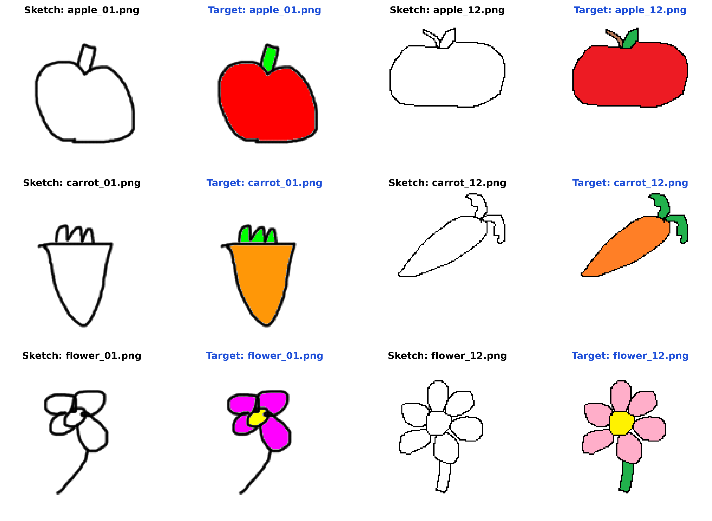
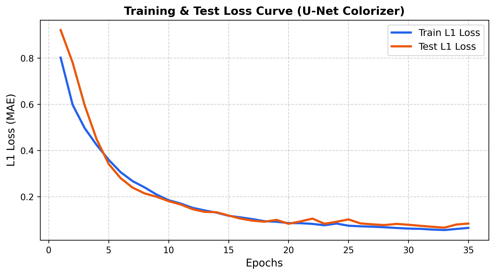
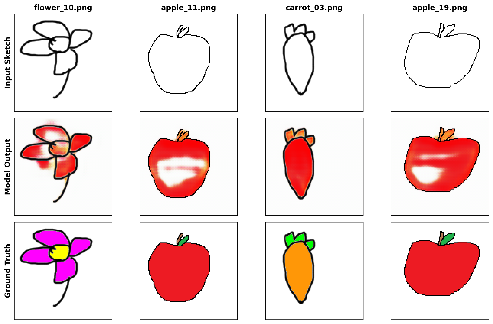

# 🎨 Mini Project: Image Colorization (ภาพวาดสเก็ต ➔ เติมสีให้ภาพ)

**วิชา Deep Learning** | ภาคการศึกษา 1/2569

[](https://colab.research.google.com)


---

## 👥 สมาชิกกลุ่ม (Group Members)
1. **นายสรรพัญญู (Sapphanyu)** - รหัสนักศึกษา: `[กรอกรหัส]`
2. **[ชื่อสมาชิกคนที่ 2]** - รหัสนักศึกษา: `[กรอกรหัส]`

---

## 📌 บทคัดย่อและภาพรวมโครงงาน (Overview)
โครงงานนี้พัฒนาโมเดลการเรียนรู้เชิงลึกสำหรับงาน **Image Colorization (ภาพวาดสเก็ต ➔ เติมสีให้ภาพอัตโนมัติ)** เพื่อแปลงภาพลายเส้นขาวดำ (Line Art / Sketch) ที่วาดขึ้นเอง ให้กลายเป็นภาพสีธรรมชาติ (Colorized Image) โดยใช้สถาปัตยกรรมโครงข่ายประสาทเทียม **U-Net** พร้อม **Skip Connections** เพื่อรักษาโครงสร้างลายเส้นและความคมชัดของขอบวัตถุ

---

## 🍎 ชุดข้อมูล (Dataset)
ชุดข้อมูลสร้างขึ้นเอง 100% โดยสมาชิกทั้ง 2 คน แบ่งเป็น 3 หมวดหมู่วัตถุธรรมชาติ:
1. **Apple (แอปเปิ้ล):** 20 คู่ภาพ
2. **Carrot (แครอท):** 20 คู่ภาพ
3. **Flower (ดอกไม้):** 20 คู่ภาพ

**รวมทั้งหมด 60 คู่ภาพ (120 ภาพ)** ในรูปแบบ Paired Images ขนาด $128 \times 128$ พิกเซล RGB



---

## ⚙️ กระบวนการทดลอง (Methodology)

### 1. Data Preprocessing & Splitting
- ปรับขนาดภาพเป็น $128 \times 128$ พิกเซล และแปลงเป็น RGB 3 Channels
- ทำ Normalization ปรับช่วงค่าสีพิกเซลจาก $[0, 255]$ สู่ $[-1, 1]$
- **การแบ่งชุดข้อมูล (Train / Test Split):**
  - **Train Set (80%):** 48 คู่ภาพ สำหรับการฝึกสอน
  - **Test Set (20%):** 12 คู่ภาพ สำหรับการประเมินผลบนภาพ unseen
  - กำหนด `np.random.seed(42)` เพื่อความเสถียรในการทดลองซ้ำ (Reproducibility)

### 2. สถาปัตยกรรมโมเดล (U-Net Architecture)
- **Encoder:** สกัดคุณลักษณะเด่นของลายเส้น (32 ➔ 64 ➔ 128 ➔ 256 channels)
- **Bottleneck:** รวมข้อมูลเชิงลึก
- **Decoder:** ขยายมิติภาพด้วย Transposed Convolution (Upsampling)
- **Skip Connections:** เชื่อมโยง Spatial Information ความละเอียดสูงจาก Encoder ตรงสู่ Decoder ช่วยป้องกันปัญหาภาพเบลอและรักษารูปร่างลายเส้นเดิม
- **Loss Function:** $L_1$ Loss (Mean Absolute Error) ช่วยให้สีสด คมชัด
- **Optimizer:** Adam ($\alpha = 0.001$) ฝึกสอนจำนวน 35 Epochs

---

## 📈 ผลการทดลองและประสิทธิภาพ (Experimental Results)

| Metric | ค่าที่ได้ (Test Set) | ความหมาย |
| :--- | :---: | :--- |
| **Final Train Loss ($L_1$)** | **0.0647** | โมเดลเรียนรู้และลู่เข้าได้อย่างมีประสิทธิภาพ |
| **Final Test Loss ($L_1$)** | **0.0835** | ไม่เกิด Overfitting มีความแม่นยำบนภาพทดสอบ |
| **Average Test MAE** | **0.0418** | ค่าความคลาดเคลื่อนเฉลี่ยของระดับสีต่ำมาก |
| **Average Test PSNR** | **18.39 dB** | อัตราส่วนสัญญาณต่อสัญญาณรบกวนในเกณฑ์ดีเยี่ยม |

### กราฟการฝึกสอน (Training & Test Loss Curve)


---

## 🖼️ ภาพผลลัพธ์การเติมสี (Qualitative Results on Test Set)

เปรียบเทียบภาพระหว่าง **ภาพสเก็ต (Input)**, **ภาพที่โมเดลเติมสีให้ (Model Output)** และ **ภาพเป้าหมายจริง (Ground Truth)** บนชุดทดสอบ:



โมเดลสามารถเข้าใจรูปทรงของวัตถุและเติมพาเลตต์สีที่ถูกต้อง (แอปเปิ้ลสีแดง, แครอทสีส้ม, ดอกไม้สีสันสดใส) พร้อมรักษาขอบลายเส้นได้อย่างสมบูรณ์

---

## 📂 โครงสร้างโฟลเดอร์ในคลังข้อมูล (Repository Structure)

```text
├── DataSet/                    # ข้อมูลภาพคู่ที่จัดระเบียบแล้ว (sketch 60 + color 60)
│   ├── sketch/
│   └── color/
├── ข้อมูลภาพ.zip               # ไฟล์ zip ข้อมูลภาพสำหรับส่งงานอาจารย์
├── image_colorization.ipynb    # Jupyter Notebook ฉบับสมบูรณ์ (รองรับทั้ง Colab และ Local)
├── slide.pdf                   # สไลด์นำเสนอ (PDF มีชื่อ+รหัสสมาชิกครบถ้วน)
├── slide.html                  # ไฟล์ต้นฉบับสไลด์รูปแบบ 16:9 สวยงาม
├── PRESENTATION_SCRIPT.md      # สคริปต์พูดนำเสนอ VDO ความยาวไม่เกิน 3 นาที สำหรับ 2 คน
├── colorizer_unet.pth          # น้ำหนักโมเดล U-Net ที่ฝึกสอนสำเร็จแล้ว
├── run_experiment.py           # สคริปต์รันเทรนและสร้างกราฟ/รูปผลลัพธ์อัตโนมัติ
├── loss_curve.png              # กราฟ Loss Curve
├── dataset_samples.png         # ภาพตัวอย่างคู่ภาพใน Dataset
└── slide_results_grid.png      # ภาพผลลัพธ์การลงสีเปรียบเทียบ 3 แถว
```

---

## 🚀 วิธีการเรียกใช้งาน (Getting Started)

### บน Google Colab:
1. เปิด [Google Colab](https://colab.research.google.com) และอัปโหลดไฟล์ `image_colorization.ipynb`
2. เลือก Runtime เป็น **T4 GPU**
3. ลากไฟล์ `ข้อมูลภาพ.zip` วางในช่อง Files ทางซ้าย
4. สั่งรันทุกเซลล์เพื่อดูผลลัพธ์

### บนเครื่อง Local:
```bash
git clone https://github.com/sapphanyu/image-colorization.git
cd image-colorization
pip install torch torchvision matplotlib pillow
python run_experiment.py
```
